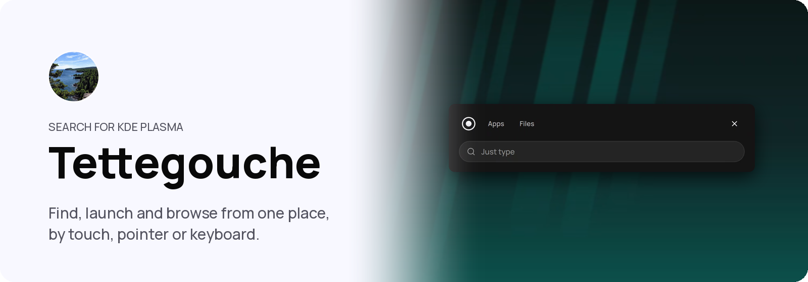
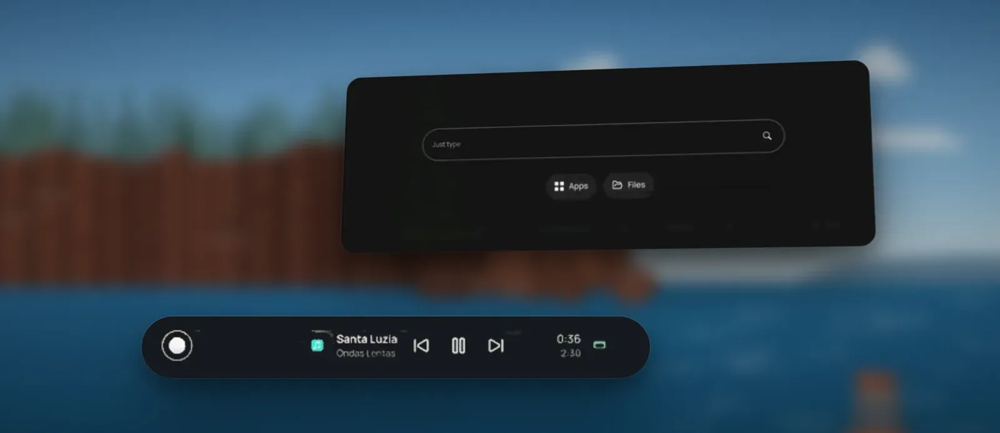

<p align="center">
  <picture>
    <source media="(prefers-color-scheme: dark)" srcset="assets/readme/banner-dark.png">
    
  </picture>
</p>

<p align="center">
  
  
  
  
</p>

<p align="center">
  <a href="#install">Install</a> · <a href="#controls">Controls</a> · <a href="docs/README.md">Docs</a> · <a href="#used-by-shuffle">Used by Shuffle</a>
</p>

<p align="center">
Tettegouche is a touch-oriented Search and file launcher for KDE Plasma. One dot
in the panel opens search, applications and files in one place, and small
islands beside it show what is happening now. Search stays on this computer.
</p>

<p align="center"></p>
<p align="center"><sub>Search open over the desktop, with music playing on the island below.</sub></p>

## What you get

<table>
<tr>
<td width="33%" valign="top"><b>Private search</b><br>Applications, files, notes, settings, sums and conversions as you type. It all stays on this computer.</td>
<td width="33%" valign="top"><b>Apps</b><br>Every application A to Z, by most used or by newest installed, with folders you make by dragging one onto another.</td>
<td width="33%" valign="top"><b>Files</b><br>A file browser with tabs, Places, drives and phones, that keeps copying safely after you close it.</td>
</tr>
<tr>
<td width="33%" valign="top"><b>Live activity</b><br>Islands in the panel for music, transfers, new downloads, drives, a shared screen and an application waiting on you.</td>
<td width="33%" valign="top"><b>Any input</b><br>Works with touch, a pointer or a keyboard, and follows your light or dark colour scheme.</td>
<td width="33%" valign="top"><b>Works on its own</b><br>Fully functional on a plain Plasma desktop, without Shuffle or its dock. Kadunce, Gooseberry or Split Rock add to it where they are installed.</td>
</tr>
</table>

## Controls

| Task | Touch | Keyboard |
| --- | --- | --- |
| Search | Tap the dot | `Meta` |
| Apps | Tap Apps in Search | `Meta+G` |
| Files | Tap Files in Search | `Meta+E` |
| Ambient | Tap the island | — |

Every other input is in [docs/INPUT.md](docs/INPUT.md).

<details>
<summary>Changing the keys</summary>

`Meta+G` and `Meta+E` are listed under Tettegouche, or Search where Shuffle is
installed, in System Settings' Shortcuts, where you can change them. Dolphin
takes `Meta+E` when it is installed; give the key to Tettegouche there. `Meta`
works with nothing to set: Tettegouche is Plasma's application launcher, as
Kickoff is.

</details>

## Search

Tap the dot in the panel, or press `Meta`. Before you type, Search offers Apps
and Files, Notes where Gooseberry is installed, Helpers where Split Rock is
installed, and below them what you used lately: files, and applications that
are not already open or pinned in the dock. To go straight to one of them,
press the dot and slide toward the islands. Search stays ready after you close
it, so it opens at once next time, and Tettegouche adds no background service
to do it.

Search stays on this computer. Files come from Baloo, KDE's built-in file
index that Dolphin also uses, so Tettegouche keeps no index of its own. Only
**Search the web** hands your words to your browser.

<details>
<summary>What Search finds</summary>

- Installed applications
- Files from KDE's file index, and recent documents. A file named for what
  you type comes first; one that only holds the words inside follows.
- Notes, while Gooseberry is running
- KDE settings
- Calculator results
- Unit conversions
- Split Rock's upkeep cards and facts, such as "update" or "storage", where
  Split Rock is installed

Local results come first. If nothing local matches, submitting the search can
open it in your web browser. Results are not ranked by what you used before.
Touch and hold an application, or right-click it, to uninstall it.

</details>

<details>
<summary>Apps</summary>

**Apps** shows installed applications when you would rather look than search.
A to Z is one run by name. Most used and Newest installed are divided into
sections by when each was last used or arrived. Apps remembers your choice.

Drag one application onto another to make a folder: a single tile at its
name's place A to Z, or at the head of its section. It opens and closes in
place. Touch and hold an application for its sheet: its own actions, folders,
Hide, Edit Application… to change its name, icon or command in KDE's menu
editor, and Uninstall…. Apps also has a launcher of its own, with its own
icon, to pin to a dock.

</details>

<details>
<summary>Files</summary>

**Files** is a local file browser inside Tettegouche. It includes Places, tabs,
history, breadcrumbs, filtering, sorting, selection, and hidden-file display.
It can pop out into a window of its own.

You can open, copy, move, rename, and delete files; create folders; drag files
between folders and to or from other applications; open drives and phones, and
eject drives; and open Trash to restore items or delete them for good. A
running file operation carries on safely if you close Search or the panel
restarts. Files browses local folders, drives and phones; network shares open
in Dolphin.

</details>

## Live activity

The islands beside the dot show what is happening now:

- Music and other media sessions
- Plasma file and desktop jobs
- Copy and move operations started in Tettegouche
- New files arriving in Downloads
- A drive or memory card plugged in: one tap opens it in Files
- A screen shared or recorded through Plasma's portal, with Stop
- An application waiting on you: one tap brings it and its dialog forward
- Where Split Rock is installed, a fact that needs attention, such as a disk
  filling up

<details>
<summary>How the islands behave</summary>

Each island's controls come from the application or service behind it. When
that source goes away, Tettegouche removes the item without guessing whether it
succeeded.

Each kind of activity is its own island, side by side and centred in the room
the panel gives them, clear so the panel shows through. When they share the
room, each gives up names first and keeps its buttons at its end. A tap opens
an island in place, larger, with the media's art, position and controls or each
transfer's own actions; a sideways flick sets one aside. The widget's setting
"Show islands beside the launcher" turns them off.

</details>

<details>
<summary>Related settings</summary>

Search can include useful information from supported Bluetooth, sound, network,
display, power, printer, storage, KDE Connect, default-application, and Night
Light settings.

These results open the matching KDE settings page, where you make any change
yourself.

</details>

<details>
<summary>On its own, or with Kadunce and Shuffle</summary>

Tettegouche works on its own. Choosing an application that is already open
brings its window forward instead of opening another: through Kadunce, which
shows the card that holds it, or through Plasma's own window list where
Kadunce is not running. Expanded Apps and Files views can also use the space
Kadunce provides.

Without Kadunce, or with a version it cannot use, Tettegouche opens in its own
window. Without Shuffle and its dock it is fully functional: that is a
supported setup, not a reduced one. Pin to dock, and the room Search leaves for
Shuffle's bars, appear only where Shuffle is installed.

</details>

## Install

```bash
./install.sh
```

The installer builds and tests Tettegouche, installs the launcher and Plasma
widget, then restarts the panel so it runs the new widget. On a first install,
open panel edit mode, choose **Add Widgets**, search for **Tettegouche**, and
add it to the panel.

<details>
<summary>Requirements</summary>

- KDE Plasma 6.7 or newer, on Wayland
- Qt 6.10 and KDE Frameworks 6.26, or newer
- LayerShellQt 6.7, BluezQt, Solid, and AppStreamQt 1.0
- CMake and a C++20 compiler
- gettext, for translations and the checks on them

Build again after each Plasma update: until then, Ambient leaves out waiting
applications and Plasma's own transfers.

Bluetooth hardware and Kadunce are optional. Some related-setting results come
from optional system tools and appear only when the tool is installed.

</details>

<details>
<summary>Uninstall</summary>

```bash
./uninstall.sh
```

Uninstalling removes Tettegouche's program, its main launcher entry and the
panel widget, and leaves this source folder in place.

</details>

## For developers

<details>
<summary>Folder map and checks</summary>

Read `AGENTS.md` before working in this repository. The documentation index is
in `docs/README.md`.

```text
src/          launcher, Search, Files, integration, and activity providers
qml/          Search and Files presentation
applet/       panel entry, Ambient island, and configuration
tests/        native, QML, private-session, packaging, and source checks
docs/         current contracts and architecture
```

Run the repository checks before opening a pull request:

```bash
./verify.sh
```

GitHub runs the same checks on every pull request and on `main`, against the
Qt and KDE packages Arch Linux ships at the time.

</details>

## Used by Shuffle

Tettegouche is a project of its own. [Shuffle](https://shuffleplasma.com), a
touch-first desktop built on KDE Plasma, includes it, and there it is called
Search. Shuffle also includes these related projects, each usable on its own:
[Kadunce](https://github.com/carlsonjm/kadunce),
[Temperance](https://github.com/carlsonjm/temperance),
[Gooseberry](https://github.com/carlsonjm/gooseberry) and
[Split Rock](https://github.com/carlsonjm/split-rock).

## License

Tettegouche is licensed under GPL-2.0-or-later.

The project names and marks are not covered by that licence. See
[TRADEMARKS.md](TRADEMARKS.md).

<p align="center"><picture><source media="(prefers-color-scheme: dark)" srcset="assets/readme/good-input-white.png"></picture></p>
